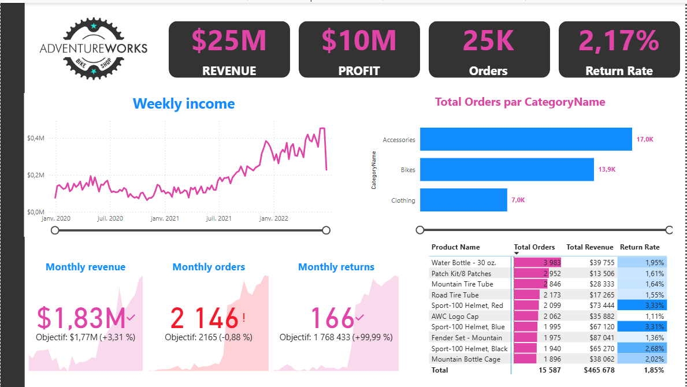

# Tableau de bord des ventes – AdventureWorks (Power BI)

TP réalisé en classe dans le cadre de mon Master 2 Business Intelligence à la Faculté des Sciences et Techniques à l'Université Cheikh Anta Diop de Dakar.
Les données viennent de la base d'exemple *AdventureWorks de Microsoft*.

## Objectif
Suivre les ventes d'une entreprise de vélos et d'accessoires :
chiffre d'affaires, profit, commandes et retours.

## Ce que le tableau de bord montre
- 4 indicateurs clés : revenu, profit, nombre de commandes, taux de retour
- L'évolution hebdomadaire du revenu (2020–2022)
- Les commandes par catégorie de produit
- Le détail par produit (commandes, revenu, taux de retour)
- Le revenu, les commandes et les retours du mois, comparés à un objectif

## Outils
Power BI, Power Query

## Contenu du dépôt
- `adventureworks.pbix` : le rapport Power BI
- `captures/` : images du rapport

## Aperçu
